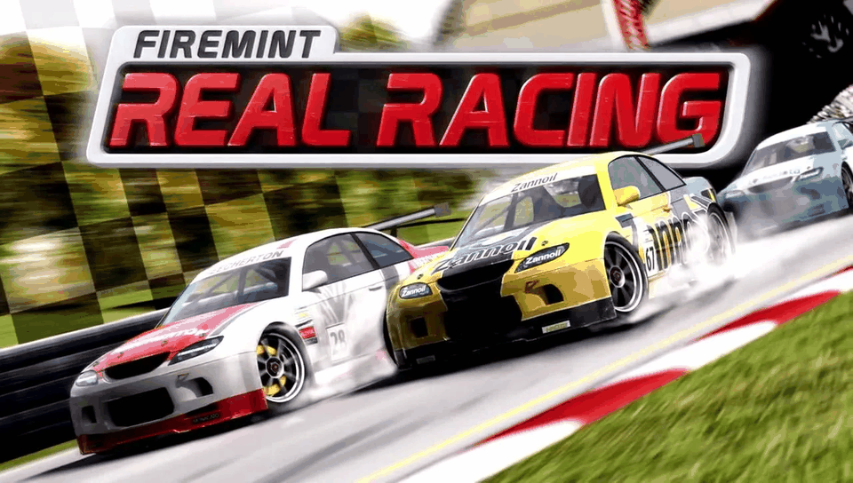

<h1 align="center">
  <br>
  Real Racing HD · PS Vita Port
</h1>

<p align="center">
  <b>Native port of Real Racing HD (Firemint) for PlayStation Vita and PlayStation TV.</b>
</p>

<p align="center">
  
  
  
  
  
  
</p>

<p align="center">
  <a href="#-description">Description</a> •
  <a href="#-features">Features</a> •
  <a href="#-controls">Controls</a> •
  <a href="#-installation">Installation</a> •
  <a href="#-known-issues">Known Issues</a> •
  <a href="#-building-from-source">Build</a> •
  <a href="#-credits">Credits</a>
</p>

---

## 📖 Description

An unofficial, native **iOS-to-PS Vita wrapper port** of *Real Racing HD* (originally developed by **Firemint**, iPad, 2010).
There is no `.so` here: this port ships its own **Mach-O loader** that maps the official armv7 iOS executable
(`RealRacingHD`, from the 1.04 IPA) into PS Vita RAM and replaces the Apple frameworks it uses (Foundation, UIKit,
CoreFoundation, CoreGraphics, CoreAudio / AudioToolbox, OpenAL, OpenGL ES) with native implementations on top of
**vitaGL**, **openal-soft**, **libmpg123** and the Vita system libraries.

The game is Firemint's own C++ engine (no middleware engine), with JSR-184 `.m3g` models from its J2ME heritage.
It runs as an iPad app (768×1024, landscape). Its picture is presented on the 960×544 screen, either as a 4:3 centered
image or stretched to 16:9.

### 🧩 Runtime components

| Component | File(s) | Role |
| :--- | :--- | :--- |
| Mach-O loader | `source/macho.c`, `tools/macho_prep.py` | Maps `__TEXT` / `__DATA` at `0x98000000`, applies `rebase.bin` (3,550 words) and binds pointers. |
| Runtime | `source/objc.c`, `source/uikit.c`, `source/darwin.c`, `tools/gen_cxx.py` | ObjC classes and categories, UIKit / Foundation / CoreFoundation shims, Darwin libc, C++ support. |
| Graphics | `source/gles.c`, `vendor/vitaGL` | GLES 1.1 on vitaGL with `SOFTFP_ABI=1`, virtual 768×1024 framebuffer, CgBI / PNG / PVR textures. |
| Audio | `source/coreaudio.c` | WAV and MP3 (libmpg123) decoded for AudioQueue and OpenAL, output on `sceAudioOut`. |
| Input | `source/input.c`, `source/patch.c` | Front touchscreen, accelerometer tilt for steering, and the physical button mapping. |
| Boot and logs | `source/main.c`, `source/log.c` | Boot checker, `res/` bucketing on first boot, crash handler that logs `[CRASH]` with Mach-O offsets. |

---

## 🎮 Status & Playability

**Status: PLAYABLE (beta) (v1.0)**

On physical PlayStation Vita hardware the game boots to the main menu in about 30 seconds, and races run smoothly.

- [x] **Mach-O loader**: loads the armv7 executable at a fixed base (`MACHO_SLIDE = 0x98000000`), applies **3,550** rebase words, resolves **1,064** import slots (0 unimplemented), runs the **6** global constructors, and enters the game. *Verified on console.*
- [x] **Graphics**: GLES 1.x → **vitaGL** (`SOFTFP_ABI=1`). The game runs as an iPad (768×1024, landscape) and its picture is presented on the 960×544 screen, either as a **4:3 centered** image or **stretched** to 16:9 (**Screen size** in the **Select + Start** options menu). Menus and races render correctly. *Verified on console.*
- [x] **Audio**: music (MP3 via libmpg123 on AudioQueue) and sound effects (OpenAL). *Verified on console.*
- [x] **Touch & Controls**: front touchscreen as the iPad screen, the left stick steers by simulating iPad tilt, and the physical buttons press the on-screen gas, brake, pause and back buttons (see [Controls](#-controls)).
- [x] **Fast loading**: on first boot the 2,148 files of `res/` are moved into 64 buckets (`rb/00`…`rb/3f`) once, with a progress bar. Boot to menu went from ~124 s to ~30 s. *Verified on console.*
- [x] **Saves**: iOS `Documents/` is redirected to `ux0:data/realracinghd/saves/`. `NSUserDefaults` and display settings are kept there too.
- [x] **No PC tools needed**: `rebase.bin` is built into the VPK. It checks the executable's size and CRC32, so a different game version is refused at boot with a message.
- [x] **Offline bypasses**: Cloudcell leaderboards, Bonjour multiplayer and Game Center are stubbed out.
- [ ] **Trophies**: not implemented yet.

### 📦 Release Package Contents (v1.0)

1. **`realracinghd.vpk`** (v01.00): PlayStation Vita application package with the Mach-O loader, vitaGL renderer, CoreAudio/OpenAL audio layer and physical input handling. It also contains **`rebase.bin`** (`app0:rebase.bin`), so no PC tools are needed.

### 📋 Changelog (v1.0)

- **Loader**: armv7 Mach-O runtime with ObjC categories, LC_DYLD_INFO binding and Thumb-2 literal handling → **3,550** rebase words, **1,064** import slots, 0 unimplemented, 6 global constructors.
- **Rebase**: PIC `__text` literals were rebased as pointers (crash in `game_translateChar`) → `macho_prep.py` drops them for PIC binaries.
- **Load times**: exFAT looks up names linearly in the 2,149-file `res/` (~250 ms per miss) → files are bucketed into `rb/XX/` on first boot. Boot to menu went from ~124 s to ~30 s.
- **Graphics**: vitaGL FFP shader failed to compile when the game used texture unit 1 alone (`undeclared identifier 'texenv0'`) → fixed in the vendored vitaGL.
- **Graphics**: crash in `glClear` → `update_scissor_test` caused by a matrix-stack overflow (vitaGL built with `SKIP_ERROR_HANDLING`) → fixed.
- **Audio**: double free in `BackgroundTrackMgr::Teardown` (AudioFileID closed twice) → live-handle table in `coreaudio.c`.
- **Audio**: ~40 s freeze when entering a race while the MP3 playlist was scanned with unbuffered reads → MP3s are read through a 64 KB buffered `FILE*`.
- **Controls**: steering direction corrected for the default `STEER_INVERT = 0`.
- **Graphics**: `glPolygonOffsetx` units are scaled from 16-bit to float depth (`DEPTH_BIAS`, logged as `[GL] glPolygonOffsetx`) as a first step on the car shadow.
- **Debugging**: kubridge exception handler logs `[CRASH]` with Mach-O offsets, registers and a stack scan; fixed the log thread priority, which had left the console logs empty.
- **Install**: `rebase.bin` is embedded in the VPK, with an executable check and a boot dialog for missing files.

---

## ✨ Features

| Feature | Status | Notes |
| :--- | :---: | :--- |
| Boots to gameplay | ✅ | Boots to the main menu in about 30 s, and races run (verified on console). |
| Graphics / renderer | ✅ | GLES 1.1 on vitaGL. 4:3 centered or stretched. Menus and races render. |
| Audio & music | ✅ | Music (MP3) and sound effects verified on console. |
| Video / cutscenes | ➖ | No video files in the IPA. The intro is an in-engine cutscene. |
| Physical buttons | 🟡 | Gas, brake, pause and back are mapped. The steering direction fix is not confirmed yet. |
| Analog sticks / camera | 🟡 | Steering works on hardware (accelerometer tilt). The direction fix in this build is not confirmed. |
| Touch screen | 🧪 | Front touchscreen drives menus and HUD. Not verified separately. |
| Button remapping / port menu | 🧪 | Select + Start options menu. Not tested on console. |
| Save data | 🧪 | Saves go to `ux0:data/realracinghd/saves/`. Survival across restarts not yet confirmed. |
| Native trophies | ❌ | Not implemented. |
| Languages | 🧪 | Language follows the Vita system language (not yet verified on console). |
| Performance | ✅ | Boot to menu in about 30 s (was ~124 s before the `res/` bucketing). Races run smoothly. |
| Online / IAP / ads | ➖ | Cloudcell leaderboards, Bonjour multiplayer and Game Center are bypassed by design. |
| PS TV | 🧪 | Not tested yet. |

Legend: `✅ Working (verified on console) · 🧪 Implemented, not yet verified on console · 🟡 Partial · ❌ Not working · ➖ Not applicable · ❔ Not documented yet`

---

## 🎯 Controls

Physical buttons are translated into touches on the game's own on-screen buttons. The touch points and steering settings can be edited in `ux0:data/realracinghd/controls.txt`.

| Input | Action |
| :---: | :--- |
| **Front Touchscreen** | iPad touch screen (menus, HUD) |
| **Left Stick / D-Pad ← →** | Steering (sent as iPad tilt) |
| **Cross (✖) / R** | Accelerate |
| **Square (◼) / L** | Brake |
| **Start** | Pause |
| **Circle (●)** | Back |
| **Select** | Toggle 4:3 centered / stretched picture |
| **Select + Start** | Options menu: remap buttons, on-screen controls, screen size (4:3 / stretched), MSAA, FPS counter/limit (saved to `options.txt` / `controls.txt`) ⚠️ Not tested on console |
| **L + R** | Show/hide the game's on-screen touch controls (they keep working) ⚠️ Not tested on console |

> [!TIP]
> `controls.txt` also has `DEADZONE`, `STEER_MAX_DEG` (tilt at full stick), `STEER_INVERT`, `TILT_BACK` and `ROTATE_180` (use it if the picture is upside down; touch input follows the picture).
> `DEPTH_BIAS` (default 256) scales the depth offset used for the car shadow (see Known Issues).

---

## 📋 Prerequisites

1. **PS Vita requirements**:
   - Custom Firmware (**Enso 3.60 / 3.65** recommended).
   - [**kubridge**](https://github.com/TheOfficialFloW/kubridge/releases) (`kubridge.skprx`) under `*KERNEL` in `ur0:tai/config.txt`:
     ```ini
     *KERNEL
     ur0:tai/kubridge.skprx
     ```
   - `libshacccg.suprx` in `ur0:data/` (extract it with [**ShaRKBR33D**](https://github.com/Rinnegatamante/ShaRKBR33D/releases/latest)).
2. **Game files**: a decrypted **Real Racing HD 1.04** iOS `.ipa` (FairPlay `cryptid 0`, `fmBuildNumber 06241337`). Open it as a ZIP and extract `Payload/RealRacingHD.app/`. No other version works.
   You provide this file yourself; it is not included in the repository.

---

## 📦 Installation

1. Copy the contents of `Payload/RealRacingHD.app/` from your IPA to `ux0:data/realracinghd/game_app/`, untouched.
2. Install `realracinghd.vpk` with **VitaShell**.
3. Launch the game. **First launch**: the game moves the files of `game_app/res/` into `game_app/rb/XX/` once, with a progress bar. This takes a few minutes. If it is interrupted, it resumes on the next boot.

### Final file structure in `ux0:data/realracinghd/`

```text
ux0:data/realracinghd/
├── game_app/      <- Contents of RealRacingHD.app from your IPA, renamed to game_app (res/ is bucketed into rb/XX/ on first launch)
├── controls.txt   <- Created automatically: button mapping and steering settings
├── options.txt    <- Display options (see Options below)
├── saves/         <- Created automatically: your save games and settings
└── logs/          <- Created automatically: realracinghd_001.log … one per run
```

### ⚙️ Options

Hold **Select + Start** in game to open the options menu. The game stays paused behind a translucent panel. **Up/Down** moves between rows, **X** changes the selected row (or assigns a new button), **Left/Right** cycles a setting, **Triangle** clears a button, and **Circle** or **Start** closes the menu and saves.

| Row | Values | Notes |
| :--- | :--- | :--- |
| One row per `controls.txt` action | the button(s) bound to it | **X**, then press the new button. If another action already uses that button, the two actions swap. **Triangle** leaves the action with no button. **Start** cancels the capture. |
| On-screen controls (L+R) | SHOWN / HIDDEN | Same as **L+R** in game. Hidden controls keep responding to touch. |
| Screen size | FULL SCREEN / ORIGINAL ASPECT | Default: the 4:3 centered picture (side bars). |
| Anti-aliasing (MSAA) | OFF / 2X / 4X | Applies after restarting the game. |
| FPS counter | OFF / ON | Top-left corner of the screen. |
| FPS limit | OFF (GAME) / 30 FPS | |

There is no screen filter row in this port: the iPad picture is reduced to the screen, so the filter choice is hidden. There is no rotation row either.

Settings are saved to `ux0:data/realracinghd/options.txt` (the button bindings go to `controls.txt`). The file can be edited by hand: `stretch=0|1` (1 = full screen), `msaa=0|2|4`, `show_fps=0|1`, `fps_cap=0|30`, `hud_hidden=0|1`.

---

## 🐛 Known Issues

- **Long first boot**: the one-time `res/` migration takes a few minutes. After that, boot to menu takes ~30 s.
- **Car shadow (under investigation)**: the shadow under the cars shows up as jagged black spikes on the road (depth fighting with the track). The game's depth offset was tuned for the iPad's 16-bit depth buffer; this build scales it for the Vita (`DEPTH_BIAS` in `controls.txt`, default 256), but that does not fix it yet.
- **Car edges**: green/cyan speckles on the edges of some cars.
- **Not available**: custom liveries from the photo library and iPod music selection are stubbed.
- **Online features disabled**: Cloudcell leaderboards, Bonjour multiplayer and Game Center are bypassed by design.
- **Fixes not yet confirmed on console**: the race-entry freeze fix and the steering direction fix are in this build but have not been confirmed on console yet.
- **No trophies yet.**
- **Crash dumps** are written by the system to `ux0:data/` (not to the game folder). The loader also logs a `[CRASH]` line with Mach-O offsets in the run's log.

---

## 🔨 Building from Source

### Prerequisites

- [VitaSDK](https://vitasdk.org/) (`$VITASDK`, softfp) with `vitaGL` (vendored), `vitashark`, `openal-soft`, `libmpg123`, `freetype`, `libpng`, `zlib`, `bzip2` and `mathneon`.
- CMake 3.14+, Python 3 (for the tools).
- The decrypted `RealRacingHD.app` folder, linked as `game_app` in the repo root (never committed).

### Compilation Commands

```bash
git clone https://github.com/MetalSyntax/Real-Racing-HD-vita.git
cd Real-Racing-HD-vita
ln -s /path/to/Payload/RealRacingHD.app game_app

# Stage the console data (copies the .app, pre-buckets res/ into rb/XX/, generates rebase.bin)
tools/stage_data.sh

# Build eboot.bin / realracinghd.vpk (rebase.bin is embedded as app0:rebase.bin)
cmake -S . -B build
cmake --build build
```

Desk test without a console (Linux ARM32 host harness): `hosttest/run.sh build && hosttest/run.sh run 300`.
This harness is an off-console check only; it is not used to verify the port on hardware.

### Deploy & Debug (over VitaShell FTP)

```bash
python3 -I tools/deploy_data.py          # incremental upload of ux0_data/realracinghd/ (never touches saves/)
python3 -I tools/deploy_data.py --logs   # fetch logs and crash dumps into ./logs/
```

A `ux0:data/realracinghd/rebase.bin` overrides the one in the VPK. A crash PC in `0x98xxxxxx` minus `0x98000000` is the address in the Mach-O: look it up in `decompiled/macho/symbols.txt` or with `python3 -I tools/annotate.py`. Architecture and progress notes: [`PORTING_PLAN.md`](PORTING_PLAN.md) and [`port_progress.md`](port_progress.md).

### What is rebase.bin?

`Real Racing HD` is a non-PIE armv7 executable linked at a fixed address. The loader maps it at `0x98000000`, and `rebase.bin` lists the **3,550** absolute 32-bit pointers in its data that must be moved to the new base. It contains offsets only, no game code. It is generated from your executable with:

```bash
python3 -I tools/macho_prep.py game_app/RealRacingHD   # run by tools/stage_data.sh
```

It ends with an `EXE1` trailer (executable size + CRC32). The loader checks it and refuses any executable other than **1.04**. A `ux0:data/realracinghd/rebase.bin` overrides the built-in one (for development).

---

## 📁 Project Structure

- `source/`: Mach-O loader, runtime, graphics, audio, input, boot checker and crash handler.
- `tools/`: `stage_data.sh`, `macho_prep.py`, `deploy_data.py`, `annotate.py`, `imports_check.py`, `gen_cxx.py`, `media_check.py`, `make_livearea.py`.
- `vendor/vitaGL/`: vitaGL built from source with `SOFTFP_ABI=1` (includes local fixes in `ffp.c`).
- `extras/`: LiveArea assets and the `controls.txt` template.
- `hosttest/`: off-console host harness.
- `decompiled/`, `docs/`: analysis dumps and reports (`docs/macho_report.txt`, `docs/imports.md`).
- `PORTING_PLAN.md`: architecture and phase plan.
- `port_progress.md`: progress log and console run history.
- `RELEASE.md`: release notes for v1.0.

---

## 📜 Disclaimer

**Real Racing** is a registered trademark of **Electronic Arts** (originally developed by **Firemint**). The work presented in this repository is unofficial and is not produced, endorsed, or sanctioned by Electronic Arts, Firemint or any affiliated entities.

This software does NOT contain original game code, binaries, copyrighted graphics, or game assets. The authors do not promote or condone piracy in any way. To play, you must provide your own legally obtained, **decrypted** copy of the iOS `.ipa`.

---

## ☕ Support My Work

This project is **free** and will stay free. If you enjoy it, a tip from **$1** helps me keep porting games to the PS Vita:

<p align="center">
  <a href="https://ko-fi.com/metalsyntax"></a>
</p>

- **Ko-fi:** [ko-fi.com/metalsyntax](https://ko-fi.com/metalsyntax)
- **PayPal:** [paypal.me/MetalSyntax](https://paypal.me/MetalSyntax)
- **Bitcoin (BTC):** `133HdCsaWxdjTfmwpgGVykByhNBV338uRc`

**Ko-fi supporters get:**
- **Early access** to new ports before their public release (test builds of upcoming projects).
- **Data preparation scripts and step-by-step guides** to set up your own game files for each new port.
- A say in which games I port next.

> Game files are never distributed. You always need your own legally obtained copy of the game.

---

## 👥 Credits

- **Real Racing HD** is intellectual property of **Electronic Arts**, originally developed by **Firemint**.
- **MetalSyntax**: this port.
- **vitaGL** graphics library by [Rinnegatamante](https://github.com/Rinnegatamante/vitaGL).
- **kubridge** plugin by [Bythos](https://github.com/bythos14/kubridge).
- **openal-soft**, **libmpg123**, **FreeType**, **libpng** and **zlib** projects.
- The **iOS Mach-O loader** is based on [`ios-loader-boilerplate`](https://github.com/MetalSyntax/ios-loader-boilerplate), [`Inotia2-vita`](https://github.com/MetalSyntax/Inotia2-vita) and the armv7 runtime of [`Block-Breaker-3-Unlimited-vita`](https://github.com/MetalSyntax/Block-Breaker-3-Unlimited-vita); the desk test harness comes from [`Skater-Nation-vita`](https://github.com/MetalSyntax/Skater-Nation-vita).
- Special thanks to the PS Vita homebrew and porting community.

---

## 📄 License

This repository does not include a LICENSE file. <!-- TODO: add the license for the port code and state it here. -->
vitaGL (`vendor/vitaGL`) is licensed under LGPL-3.0. The game, its assets and its binaries are not distributed with this project.
