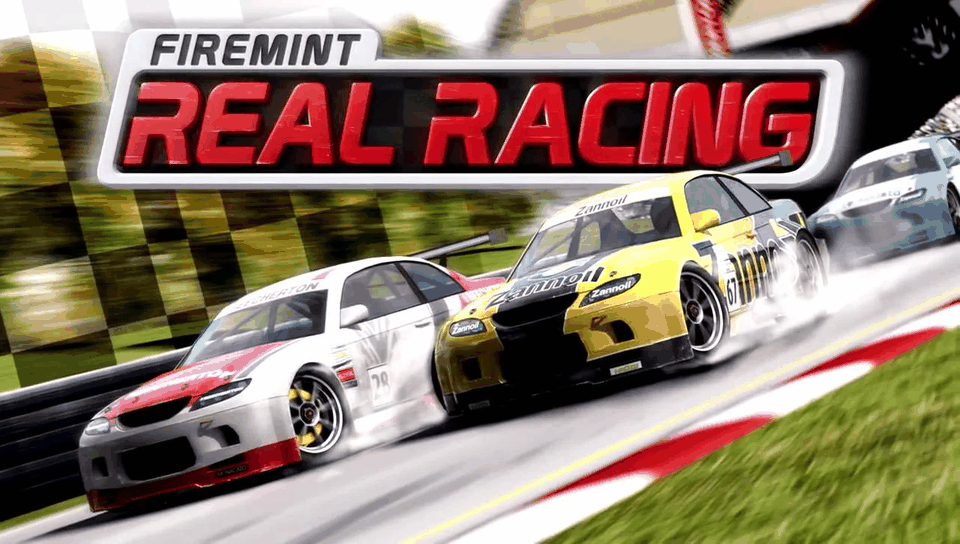

<h1 align="center">
  <br>
  Real Racing HD · PS Vita Port
</h1>

<p align="center">
  <a href="#-status--playability">Status & Playability</a> •
  <a href="#setup-instructions-for-players">How to install</a> •
  <a href="#controls">Controls</a> •
  <a href="#known-issues">Known Issues</a> •
  <a href="#build-instructions-for-developers">How to compile</a> •
  <a href="#credits--acknowledgments">Credits</a>
</p>

An unofficial, native **iOS-to-PS Vita wrapper port** of *Real Racing HD* (originally developed by **Firemint**, iPad, 2010). There is no `.so` here: this port ships its own **Mach-O loader** that maps the official armv7 iOS executable (`RealRacingHD`, from the 1.04 IPA) into PS Vita RAM and replaces the Apple frameworks it uses (Foundation, UIKit, CoreFoundation, CoreGraphics, CoreAudio / AudioToolbox, OpenAL, OpenGL ES) with native implementations on top of **vitaGL**, **openal-soft**, **libmpg123** and the Vita system libraries.

---

## 🎮 Status & Playability

**Status: PLAYABLE (beta) (v1.0)**

On physical PlayStation Vita hardware the game boots to the main menu in about 30 seconds, and races run smoothly.

- [x] **Mach-O loader**: loads the armv7 executable at a fixed base (`MACHO_SLIDE = 0x98000000`), applies **3,550** rebase words, resolves **1,064** import slots (0 unimplemented), runs the **6** global constructors, and enters the game. *Verified on console.*
- [x] **Graphics**: GLES 1.x → **vitaGL** (`SOFTFP_ABI=1`). The game runs as an iPad (768×1024, landscape) and its picture is presented on the 960×544 screen, either as a **4:3 centered** image or **stretched** to 16:9 (toggle with **Select**). Menus and races render correctly. *Verified on console.*
- [x] **Audio**: music (MP3 via libmpg123 on AudioQueue) and sound effects (OpenAL). *Verified on console.*
- [x] **Touch & Controls**: front touchscreen as the iPad screen, the left stick steers by simulating iPad tilt, and the physical buttons press the on-screen gas, brake, pause and back buttons (see [Controls](#controls)).
- [x] **Fast loading**: on first boot the 2,148 files of `res/` are moved into 64 buckets (`rb/00`…`rb/3f`) once, with a progress bar. Boot to menu went from ~124 s to ~30 s. *Verified on console.*
- [x] **Saves**: iOS `Documents/` is redirected to `ux0:data/realracinghd/saves/`. `NSUserDefaults` and display settings are kept there too.
- [x] **No PC tools needed**: `rebase.bin` is built into the VPK. It checks the executable's size and CRC32, so a different game version is refused at boot with a message.
- [x] **Offline bypasses**: Cloudcell leaderboards, Bonjour multiplayer and Game Center are stubbed out.
- [ ] **Trophies**: not implemented yet.

---

## Disclaimer

**Real Racing** is a registered trademark of **Electronic Arts** (originally developed by **Firemint**). The work presented in this repository is unofficial and is not produced, endorsed, or sanctioned by Electronic Arts, Firemint or any affiliated entities.

This software does NOT contain original game code, binaries, copyrighted graphics, or game assets. The authors do not promote or condone piracy in any way. To play, you must provide your own legally obtained, **decrypted** copy of the iOS `.ipa`.

---

## Setup Instructions (For Players)

1. **CFW & Plugins**: PS Vita on Custom Firmware (**Enso 3.60 / 3.65** recommended) with `kubridge` under `*KERNEL` in `ur0:tai/config.txt`:
   ```ini
   *KERNEL
   ur0:tai/kubridge.skprx
   ```
2. **Shader Compiler**: `libshacccg.suprx` must be in `ur0:data/` (extract it with **ShaRKBR33D**).
3. **Game Files**: a decrypted **Real Racing HD 1.04** iOS `.ipa` (FairPlay `cryptid 0`, `fmBuildNumber 06241337`). Open it as a ZIP and extract `Payload/RealRacingHD.app/`. No other version works.
4. **Copy to the Vita** (`ux0:data/realracinghd/`):
   ```
   ux0:data/realracinghd/
     game_app/      the contents of RealRacingHD.app from the IPA, untouched (renamed to game_app)
     controls.txt   created automatically — button mapping and steering settings
     saves/         created automatically — your save games and settings
     logs/          created automatically — realracinghd_001.log … one per run
   ```
5. **Install VPK**: install `realracinghd.vpk` with VitaShell.
6. **First launch**: the game moves the files of `game_app/res/` into `game_app/rb/XX/` once, with a progress bar. This takes a few minutes. If it is interrupted, it resumes on the next boot.

---

## Controls

Physical buttons are translated into touches on the game's own on-screen buttons. The touch points and steering settings can be edited in `ux0:data/realracinghd/controls.txt`.

| Input | Action |
| :---: | :--- |
| **Front Touchscreen** | iPad touch screen (menus, HUD) |
| **Left Stick / D-Pad ← →** | Steering (sent as iPad tilt) |
| **Cross (✖) / R** | Accelerate |
| **Square (◼) / L** | Brake |
| **Start** | Pause |
| **Circle (●)** | Back |
| **Select** | Toggle 4:3 centered / stretched picture |

> [!TIP]
> `controls.txt` also has `DEADZONE`, `STEER_MAX_DEG` (tilt at full stick), `STEER_INVERT`, `TILT_BACK` and `ROTATE_180` (use it if the picture is upside down; touch input follows the picture).

---

## Known Issues

- **Long first boot**: the one-time `res/` migration takes a few minutes. After that, boot to menu takes ~30 s.
- **Car shadow (under investigation)**: the shadow under the cars shows up as jagged black spikes on the road (depth fighting with the track). The game's depth offset was tuned for the iPad's 16-bit depth buffer; this build scales it for the Vita (`DEPTH_BIAS` in `controls.txt`, default 256), but that does not fix it yet.
- **Car edges**: green/cyan speckles on the edges of some cars.
- **Not available**: custom liveries from the photo library and iPod music selection are stubbed.
- **Online features disabled**: Cloudcell leaderboards, Bonjour multiplayer and Game Center are bypassed by design.
- **Crash dumps** are written by the system to `ux0:data/` (not to the game folder). The loader also logs a `[CRASH]` line with Mach-O offsets in the run's log.

---

## Build Instructions (For Developers)

### Prerequisites

- [VitaSDK](https://vitasdk.org/) (`$VITASDK`, softfp) with `vitaGL` (vendored), `vitashark`, `openal-soft`, `libmpg123`, `freetype`, `libpng`, `zlib`, `bzip2` and `mathneon`.
- CMake 3.14+, Python 3 (for the tools).
- The decrypted `RealRacingHD.app` folder, linked as `game_app` in the repo root (never committed).

### Compilation Commands

```bash
git clone https://github.com/MetalSyntax/Real-Racing-HD-vita.git
cd Real-Racing-HD-vita
ln -s /path/to/Payload/RealRacingHD.app game_app

# Stage the console data (copies the .app, pre-buckets res/ into rb/XX/, generates rebase.bin)
tools/stage_data.sh

# Build eboot.bin / realracinghd.vpk (rebase.bin is embedded as app0:rebase.bin)
cmake -S . -B build
cmake --build build
```

Desk test without a console (Linux ARM32 host harness): `hosttest/run.sh build && hosttest/run.sh run 300`.

### Deploy & Debug (over VitaShell FTP)

```bash
python3 -I tools/deploy_data.py          # incremental upload of ux0_data/realracinghd/ (never touches saves/)
python3 -I tools/deploy_data.py --logs   # fetch logs and crash dumps into ./logs/
```

A `ux0:data/realracinghd/rebase.bin` overrides the one in the VPK. A crash PC in `0x98xxxxxx` minus `0x98000000` is the address in the Mach-O: look it up in `decompiled/macho/symbols.txt` or with `python3 -I tools/annotate.py`. Architecture and progress notes: [`PORTING_PLAN.md`](PORTING_PLAN.md) and [`port_progress.md`](port_progress.md).

---

## ☕ Support My Work

This project is **free** and will stay free. If you enjoy it, a tip from **$1** helps me keep porting games to the PS Vita:

<p align="center">
  <a href="https://ko-fi.com/metalsyntax"></a>
</p>

- **Ko-fi:** [ko-fi.com/metalsyntax](https://ko-fi.com/metalsyntax)
- **PayPal:** [paypal.me/MetalSyntax](https://paypal.me/MetalSyntax)
- **Bitcoin (BTC):** `133HdCsaWxdjTfmwpgGVykByhNBV338uRc`

**Ko-fi supporters get:**
- **Early access** to new ports before their public release (test builds of upcoming projects).
- **Data preparation scripts and step-by-step guides** to set up your own game files for each new port.
- A say in which games I port next.

> Game files are never distributed. You always need your own legally obtained copy of the game.

---

## Credits & Acknowledgments

- **Real Racing HD** is intellectual property of **Electronic Arts**, originally developed by **Firemint**.
- **vitaGL** graphics library by [Rinnegatamante](https://github.com/Rinnegatamante/vitaGL).
- **kubridge** plugin by [Bythos](https://github.com/bythos14/kubridge).
- **openal-soft**, **libmpg123**, **FreeType**, **libpng** and **zlib** projects.
- The **iOS Mach-O loader** is based on [`ios-loader-boilerplate`](https://github.com/MetalSyntax/ios-loader-boilerplate), [`Inotia2-vita`](https://github.com/MetalSyntax/Inotia2-vita) and the armv7 runtime of [`Block-Breaker-3-Unlimited-vita`](https://github.com/MetalSyntax/Block-Breaker-3-Unlimited-vita); the desk test harness comes from [`Skater-Nation-vita`](https://github.com/MetalSyntax/Skater-Nation-vita).
- Special thanks to the PS Vita homebrew and porting community.
